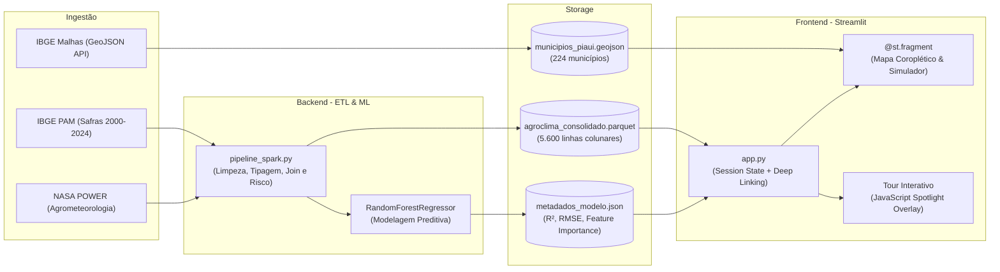

# ZeaPI · Inteligência Agroclimática e Risco Hídrico do Piauí 🌽🌱

[](https://www.python.org/)
[](https://streamlit.io/)
[](https://scikit-learn.org/)
[](https://plotly.com/)
[](https://parquet.apache.org/)
[](LICENSE)

> Plataforma analítica executiva de apoio à decisão agrícola e monitoramento da produtividade do milho (*Zea mays*) no estado do Piauí. Integra 25 safras históricas (2000–2024), climatologia de superfície via satélite e modelos preditivos de machine learning.

---

## 📌 Sumário
- [Visão Geral](#-visão-geral)
- [Arquitetura do Sistema](#-arquitetura-do-sistema)
- [Fontes de Dados Oficiais](#-fontes-de-dados-oficiais)
- [Recursos Principais](#-recursos-principais)
- [Modelagem Matemática & Simulação](#-modelagem-matemática--simulação)
- [Estrutura do Repositório](#-estrutura-do-repositório)
- [Como Instalar e Executar](#-como-instalar-e-executar)
- [Governança e Metodologia](#-governança-e-metodologia)

---

## 🌾 Visão Geral

O estado do Piauí é o 3º maior produtor agrícola do Nordeste, destacando-se na fronteira do **MATOPIBA** (polo de Uruçuí, Baixa Grande do Ribeiro e Bom Jesus). No entanto, a cultura do milho enfrenta alta vulnerabilidade a estresses agroclimáticos, alternando entre safras recordes (> 2,7 Mi t em 2023) e quebras catastróficas sob secas e El Niño (< 455 kg/ha e perdas > 28% em 2012 e 2016).

O **ZeaPI** substitui relatórios descritivos tradicionais por um ecossistema inteligente de diagnóstico causal:
1. **O que aconteceu:** Quantificação precisa de volumes colhidos e perdas de área.
2. **Por que aconteceu:** Decomposição de anomalias pluviométricas e estresse térmico diurno/noturno.
3. **Como mitigar:** Recomendações agronômicas estruturadas para curto, médio e longo prazo.
4. **O que esperar:** Simulação biofísica não linear de cenários climáticos futuros e estimativa de impacto financeiro (Inside Sales).

---

## 🏗 Arquitetura do Sistema



---

## 🛰 Fontes de Dados Oficiais

* **IBGE - Pesquisa Agrícola Municipal (PAM):** Séries históricas de área plantada (ha), área colhida (ha), quantidade produzida (t) e rendimento médio (kg/ha) para os 224 municípios piauienses.
* **NASA POWER API (Prediction of Worldwide Energy Resources):** Climatologia diária acumulada de precipitação pluviométrica (mm), temperaturas médias, máximas e mínimas (°C) e graus-dia de desenvolvimento.
* **IBGE Malhas Geográficas:** Malha municipal vetorial oficial em formato GeoJSON (UF 22 - Piauí).

---

## ✨ Recursos Principais

* **Série Histórica & Gráfico Dual-Axis:** Correlação visual direta entre curvas de rendimento (kg/ha) e precipitação anual (mm) ao longo de 25 safras.
* **Sensibilidade Hídrica (Scatter Multidimensional):** Identificação de dispersão de risco, com bolhas dimensionadas por área plantada.
* **Mapa Coroplético Municipal Interativo:** Renderização geoespacial dos 224 municípios via Plotly MapLibre, com alternância de métricas isolada em `@st.fragment`.
* **Simulador de Choques Climáticos:** Teste de sensibilidade biofísica para anomalias pluviométricas e térmicas com recálculo instantâneo.
* **Interpretabilidade de Machine Learning:** Transparência de governança algorítmica ($R^2$, RMSE e importância relativa das variáveis).
* **Tour Guiado Interativo (Spotlight):** Guia visual em 7 etapas com máscara de foco escurecida (`box-shadow`), navegação passo a passo e autoinício via `sessionStorage`.

---

## 📐 Modelagem Matemática & Simulação

O simulador biofísico calcula o rendimento projetado ($R_{proj}$) aplicando fatores de penalização sobre a linha de base histórica ($R_{base}$, $P_{base}$):

1. **Precipitação Projetada:**
   $$P_{sim} = \max\left(0,\, P_{base} \times \left(1 + \frac{\Delta_{chuva}}{100}\right)\right)$$

2. **Elasticidade Hídrica (Resposta Não Linear):**
   $$F_{hidrico} = \left(\frac{P_{sim}}{P_{base}}\right)^{0.78}$$

3. **Penalização por Estresse Térmico:**
   $$F_{termico} = \max\left(0.55,\, 1.0 - \max(0,\, \Delta_{temp}) \times 0.065\right)$$

4. **Rendimento Projetado e Volume Físico:**
   $$R_{proj} = R_{base} \times F_{hidrico} \times F_{termico}$$
   $$\text{Produção Total (t)} = \frac{\text{Área Plantada (ha)} \times R_{proj}}{1000}$$

---

## 📁 Estrutura do Repositório

```text
ZeaPI-monitoramento_agricola/
├── backend/
│   └── pipeline_spark.py      # Pipeline ETL, limpeza, cálculo de risco e ML
├── data/
│   ├── raw/                   # CSVs brutos do IBGE e NASA POWER
│   │   ├── ibge_milho_piaui_2000_2024.csv
│   │   └── nasa_power_piaui_2000_2024.csv
│   └── processed/             # Base colunar Parquet, metadados e GeoJSON
│       ├── agroclima_consolidado.parquet
│       ├── metadados_modelo.json
│       ├── modelo_rf.joblib
│       └── municipios_piaui.geojson
├── frontend/
│   ├── .streamlit/
│   │   └── config.toml        # Configurações de tema e servidor
│   └── app.py                 # Interface Streamlit (Dashboards, Mapa, Tour)
├── .gitignore                 # Exclusão de venv, caches e logs
├── requirements.txt           # Dependências versionadas do projeto
└── README.md                  # Documentação executiva e técnica
```

---

## 🚀 Como Instalar e Executar

### Pré-requisitos
* Python 3.10 ou superior
* Git instalado

### 1. Clonar o Repositório
```bash
git clone https://github.com/seu-usuario/ZeaPI-monitoramento_agricola.git
cd ZeaPI-monitoramento_agricola
```

### 2. Criar e Ativar o Ambiente Virtual
* **No Linux/macOS:**
  ```bash
  python3 -m venv .venv
  source .venv/bin/activate
  ```
* **No Windows (PowerShell):**
  ```powershell
  python -m venv .venv
  .\.venv\Scripts\Activate.ps1
  ```

### 3. Instalar Dependências
```bash
pip install --upgrade pip
pip install -r requirements.txt
```

### 4. Executar o Pipeline ETL (Opcional - Base já processada inclusa)
```bash
python backend/pipeline_spark.py
```

### 5. Iniciar a Aplicação Streamlit
```bash
streamlit run frontend/app.py
```
Acesse a plataforma no seu navegador em: `http://localhost:8501`.

---

## 📊 Governança e Metodologia

* **Modelo Preditivo:** `RandomForestRegressor (100 árvores, max_depth=8)`
* **Acurácia (Holdout Test 20%):** $R^2 = 39,61\%$, $\text{RMSE} = 1.119,86\text{ kg/ha}$
* **Importância de Features:**
  * `area_plantada_ha`: **65,36%** (Proxy de escala e tecnificação de maquinário)
  * `precipitacao_anual_mm`: **14,33%** (Disponibilidade hídrica)
  * `temp_max_c`: **6,54%** (Estresse reprodutivo e abortamento floral)
  * `temp_min_c`: **6,33%** (Respiração celular noturna)
  * `graus_dia_base10`: **5,22%** (Acúmulo térmico fenológico)
  * `temp_media_c`: **2,22%** (Condição média de fundo)

---

## 📄 Licença
Distribuído sob a licença MIT. Consulte `LICENSE` para mais detalhes.
